# 🏦 Bank Management System

A desktop banking application developed using **C#**, **.NET 10**, and **Windows Forms**.

The application provides an integrated system for managing bank clients, users, financial transactions, and currency operations.

## 🏗️ Architecture

The project follows a **Three-Tier Architecture**:

- **Presentation Layer:** Responsible for the graphical user interface and user interactions.
- **Business Layer:** Responsible for business logic and processing operations.
- **Data Access Layer:** Responsible for database communication and data management.

## ✨ Features

- User Login and Registration.
- Client Management (Add, Find, Update, Delete, List).
- User Management (Add, Find, Update, Delete, List).
- Deposit and Withdrawal Operations.
- Money Transfer.
- Transfer History.
- Currency Management.
- Currency Calculator.
- Reusable UserControls.

## 💻 Presentation Layer

| Class | Description | Source Code |
|---|---|---|
| `Program.cs` | Application entry point | [View](Program.cs) |
| `frmLogin` | Login form | [View](frmLogin.cs) |
| `frmShowMainMenue` | Main application window | [View](frmShowMainMenue.cs) |
| `UC_Home` | Home screen | [View](UC_Home.cs) |
| `UC_AddClient` | Add a new client | [View](UC_AddClient.cs) |
| `UC_FindClient` | Find a client | [View](UC_FindClient.cs) |
| `UC_UpdateClient` | Update client information | [View](UC_UpdateClient.cs) |
| `UC_DeleteClient1` | Delete a client | [View](UC_DeleteClient1.cs) |
| `UC_ClientsList` | Display clients | [View](UC_ClientsList.cs) |
| `UC_AddNewUser` | Add a new user | [View](UC_AddNewUser.cs) |
| `UC_FindUser` | Find a user | [View](UC_FindUser.cs) |
| `UpdateUser_UC` | Update user information | [View](UpdateUser_UC.cs) |
| `UC_DeleteUser` | Delete a user | [View](UC_DeleteUser.cs) |
| `UC_UsersList` | Display users | [View](UC_UsersList.cs) |
| `UC_DepositAmount` | Deposit operation | [View](UC_DepositAmount.cs) |
| `UC_WithdrawlAmountcs` | Withdrawal operation | [View](UC_WithdrawlAmountcs.cs) |
| `UC_TransferMony` | Money transfer | [View](UC_TransferMony.cs) |
| `UC_TransferLog` | Transfer history | [View](UC_TransferLog.cs) |
| `UC_CurrenciesList` | Currency list | [View](UC_CurrenciesList.cs) |
| `UC_CurrrencyCalculator` | Currency calculator | [View](UC_CurrrencyCalculator.cs) |
| `clsBasTransActions` | Base transaction actions | [View](clsBasTransActions.cs) |
| `ICloseableUserControl` | UserControl interface | [View](ICloseableUserControl.cs) |

## 🖼️ Screenshots

### Main Interface

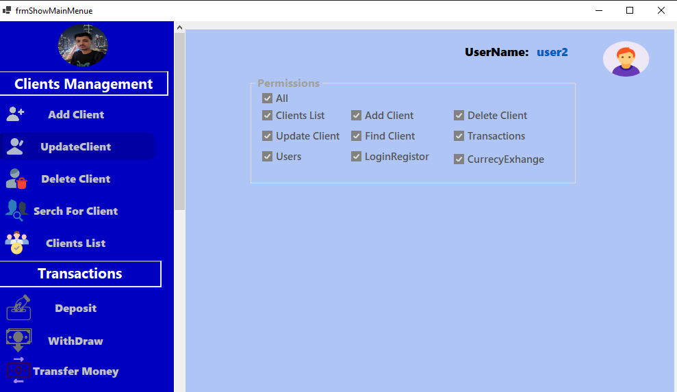

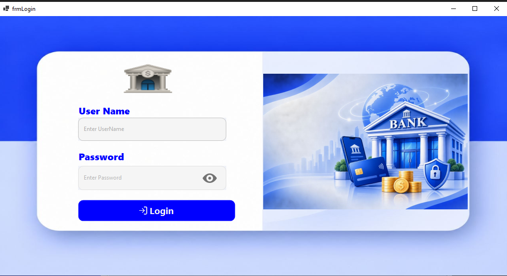

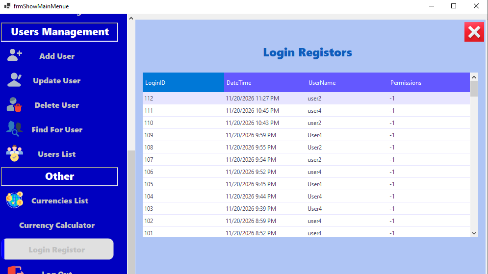

### Client Management

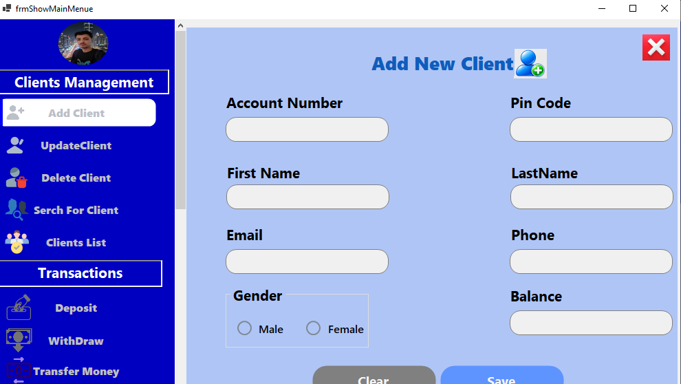

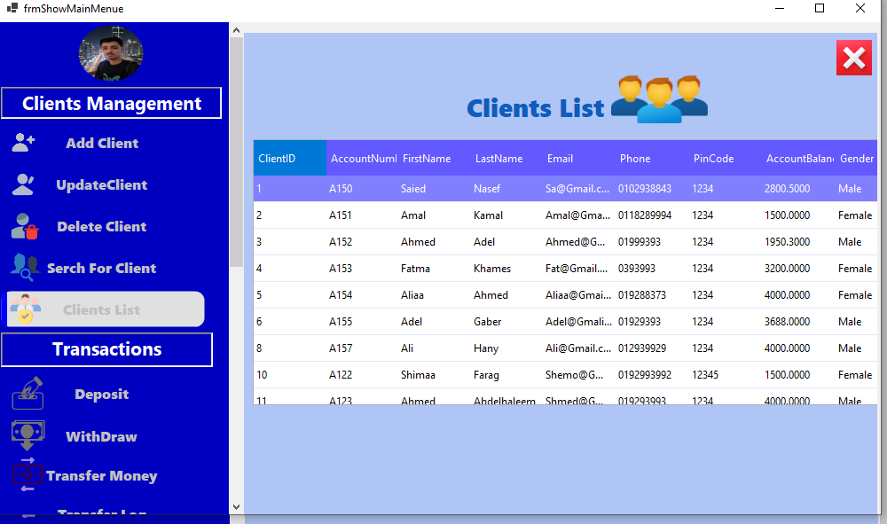

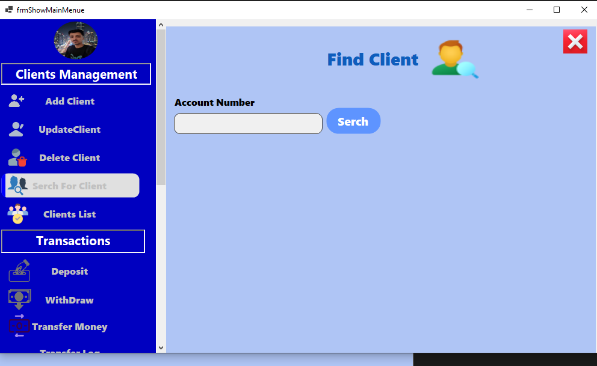

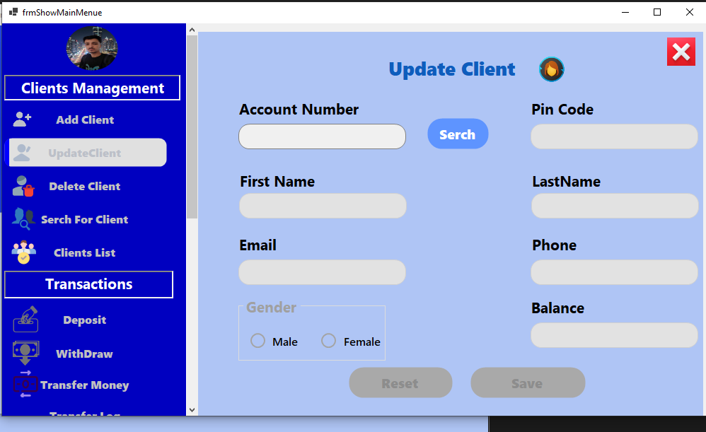

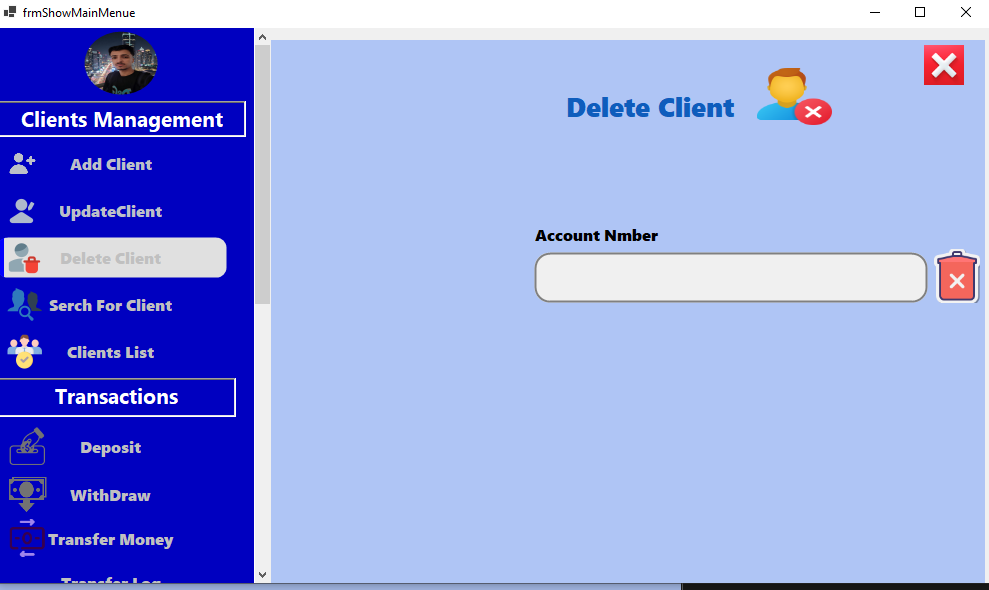

### Banking Operations

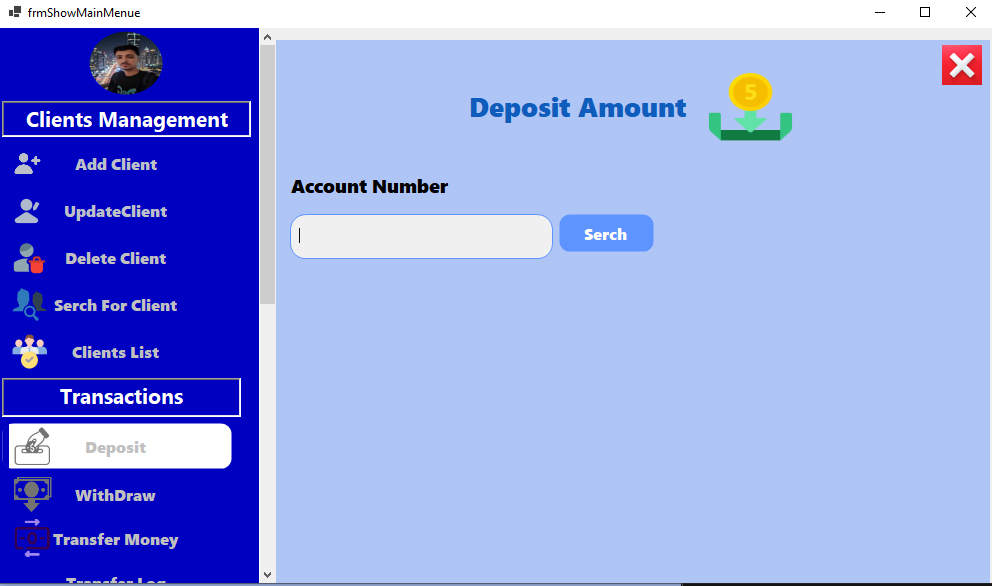

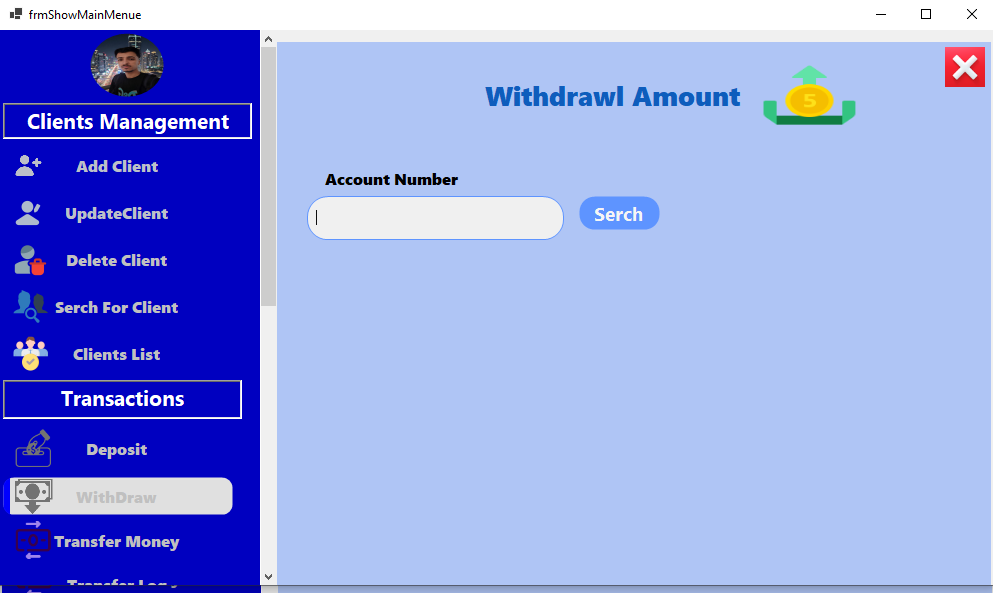

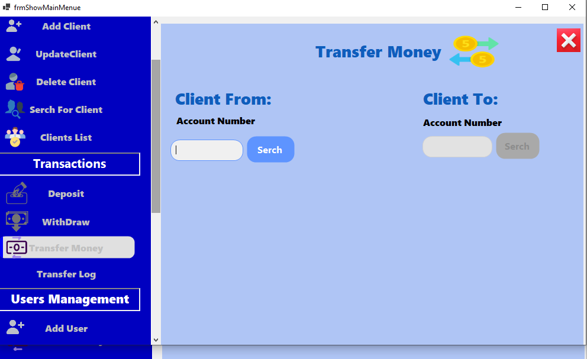

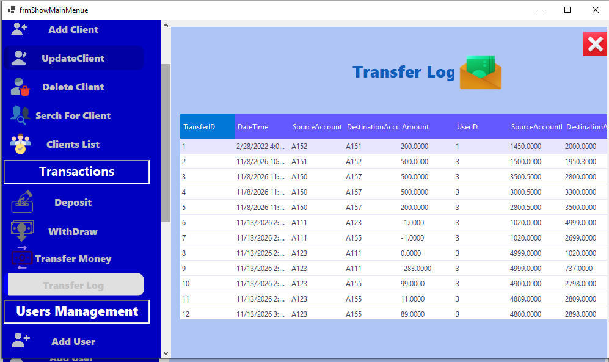

### Currency Management

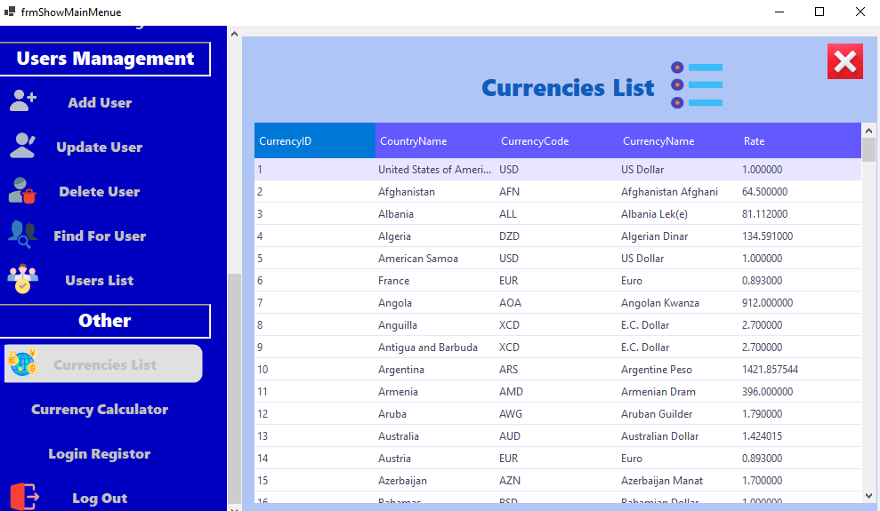

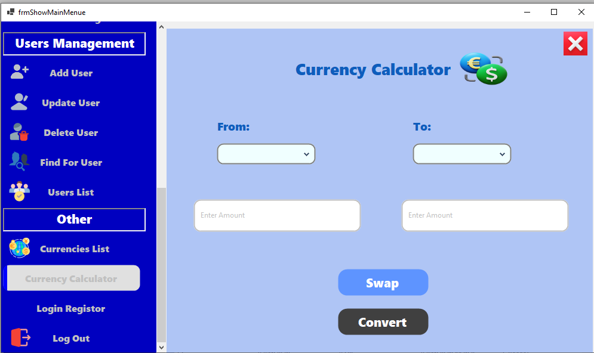

## 🛠️ Technologies

- C#
- .NET 10
- Windows Forms
- SQL Server
- Visual Studio
- Three-Tier Architecture

## 🚀 Getting Started

1. Clone the repository.
2. Open `Project_Bank_System_Level2.slnx` in Visual Studio.
3. Restore the required NuGet packages.
4. Configure the database connection.
5. Build and run the application.

---

**Developed as a Bank Management System project.**
